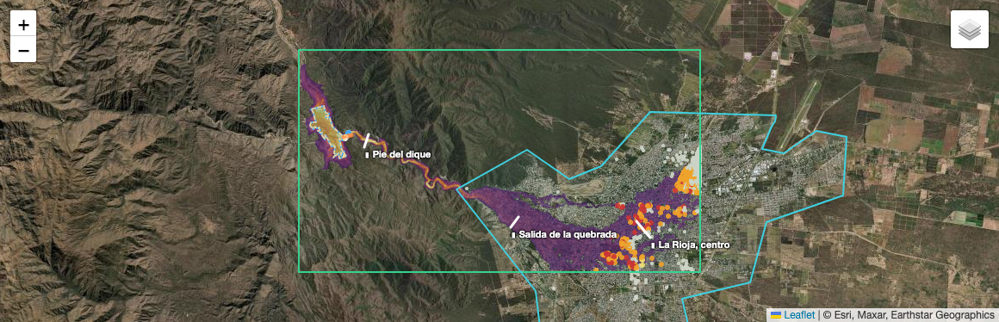
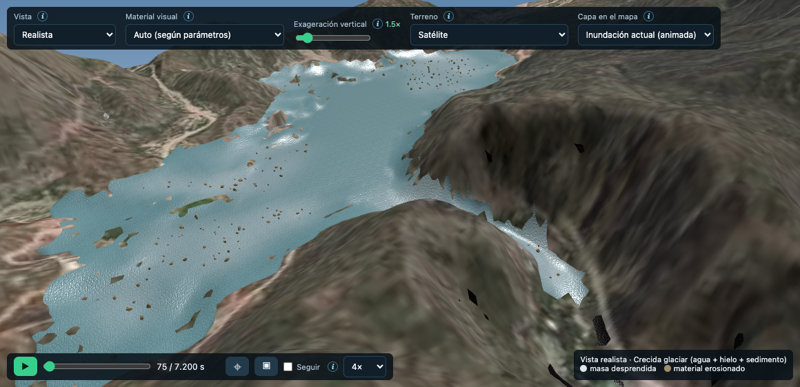
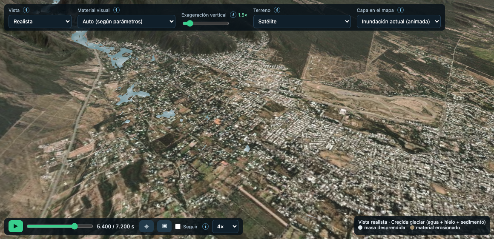

# Ejemplo: rotura del paredón del Dique Los Sauces → Río Los Sauces → La Rioja (hipotético)

> **Escenario hipotético.** No representa un evento ocurrido ni un pronóstico, y no evalúa el estado real de la presa. Es un caso de demostración de un análisis de rotura de presa (*dam-break*), del tipo que se usa para preparar planes de acción ante emergencias.

## Cómo ejecutarlo

En la app: **Ejemplos → "Dique Los Sauces → Río Los Sauces → La Rioja…" → ▶ Cargar y simular**. Son 2 horas de evento y en una GPU integrada tarda ~25–40 min. Al terminar queda en t = 0: con ▶ se ve la rotura, el vaciado del embalse y el avance de la crecida.

Archivo del escenario: [`frontend/examples/dique_los_sauces.json`](../frontend/examples/dique_los_sauces.json).

## El sistema

- **Embalse**: Dique Los Sauces, 1,04 km² de espejo (OSM), con el agua a ~849 m según el DEM. Su paredón tiene más de 90 años.
- **Aportes**: el Río Grande de Sanagasta, que llega desde el norte y el noroeste y aporta agua en buena parte por el subálveo, y la quebrada que entra desde el suroeste.
- **Salidas**: el vertedero, en el estribo este, y el desagüe de fondo al pie del paredón, que descarga en el Río (Arroyo) Los Sauces.
- **Aguas abajo**: una quebrada de ~11 km hasta el ápice del abanico aluvial donde se asienta la ciudad de La Rioja. El centro está a ~16,5 km del dique y ~330 m más abajo.

## Escenario: sobrecarga de agua y sedimento

1. Una crecida del Río Grande de Sanagasta eleva el embalse a **851 m**, 2 m por encima del vertedero y 1 m por debajo del coronamiento. El vertedero ya está descargando.
2. El vaso está **muy colmatado**: 8 m de sedimento fino saturado bajo 5 m de agua. Esa colmatación y la crecida aumentan el empuje sobre un muro de más de 90 años.
3. A los **20 s** el paredón colapsa en la garganta y en **2 minutos** el muro desaparece hasta el pie (822 m), como en una presa de gravedad.
4. El agua sale por la brecha y **erosiona el sedimento acumulado** (erosión retrógrada): el limo pasa a la crecida en suspensión, como un flujo hiperconcentrado (~1600 kg/m³).
5. La crecida baja por la quebrada del Río Los Sauces, erosiona su lecho y se abre sobre el abanico aluvial de La Rioja.

## Datos y supuestos

| Elemento | Valor | Origen |
|---|---|---|
| Zona de cálculo | −66,995 / −66,835 · −29,445 / −29,370 (15,5 × 8,3 km) | Del embalse al centro de La Rioja |
| Terreno | AWS Terrain Tiles (~30 m) | El muro y la garganta no se resuelven a 30 m |
| Embalse | Polígono de OSM (1,04 km²), nivel 851 m | Nivel de crecida (*supuesto*) |
| Paredón | Coronamiento **852 m**, pie **822 m** (~30 m de altura), 20 m de ancho, eje de OSM | *Supuesto*: no hay datos de proyecto en las fuentes abiertas; se construye sobre el DEM |
| Vertedero | Estribo este, cresta **849 m** | *Supuesto* (nivel normal del embalse en el DEM) |
| Agua | **5,0 M m³** (5 m sobre el sedimento) | *Supuesto* |
| Sedimento acumulado | **8 m** de limo saturado en todo el vaso (~8 M m³), erosionable, que se incorpora en suspensión | *Supuesto*: representa un vaso colmatado en más de la mitad de su volumen |
| Rotura | Brecha de 110 m de ancho hasta 822 m, entre t = 20 s y 140 s | Rotura brusca de un muro de gravedad |
| Quebrada | Cauce grabado: 100 m × 2 m en la garganta (km 0–2,5) y 60 m × 1 m hasta el km 11; 1,5 m de lecho erosionable | Cauce de conducción equivalente: la garganta queda cerrada en el DEM de 30 m |
| Rugosidad | Voellmy ξ = 800 m/s² para el agua y 600 para la mezcla | Equivale a Manning n ≈ 0,04–0,05 |
| Solver | MPM 3D, dx 20 m pedido (22,8 m aplicado por memoria), 3 partículas por celda y eje, 2 h de evento | ~23 M de nodos |
| Aforos | Pie del dique (km 1), salida de la quebrada (km 10), centro de La Rioja (km 16,5) | Secciones transversales |
| Exposición | Ejido de La Rioja (90,8 km², OSM) y 1931 edificios de OSM | **La cobertura de edificios de OSM en La Rioja es parcial**: el conteo subestima |

## Resultados

Corrida de referencia: MPM 3D en la GPU (Metal), dx 22,8 m (el backend lo ajustó por memoria), 2 h de evento.

### Cronología (desde t = 0; el muro empieza a colapsar a los 20 s)

| Tiempo | Qué pasa |
|---|---|
| 0 – 20 s | Embalse a 851 m. El vertedero descarga |
| 20 s – 2,3 min | Colapso del paredón hasta el pie |
| **~3 min** | **Caudal pico al pie del dique: ~1.600 m³/s** (hasta 7 m de tirante y 6 m/s) |
| 3 – 30 min | El agua erosiona el sedimento del vaso y la crecida baja por la quebrada |
| **~22 min** | **La crecida sale de la quebrada y entra al sector oeste del ejido de La Rioja** |
| 37 min | Pasa por la salida de la quebrada (km 10) |
| **~78 min** | **Llega a la zona del centro (km 16,5)**, ya atenuada: pico de ~260 m³/s a los 90 min |

### Hidrogramas

| Estación | Caudal pico | Hora del pico | Volumen en 2 h |
|---|---|---|---|
| Pie del dique (km 1) | ~1.600 m³/s | 3 min | 3,2 M m³ |
| Salida de la quebrada (km 10) | ~450 m³/s | 76 min | 1,2 M m³ |
| La Rioja, centro (km 16,5) | ~260 m³/s | 90 min | 0,4 M m³ |

La crecida **se atenúa mucho** en el recorrido: la quebrada y, sobre todo, el abanico aluvial almacenan y distribuyen el agua. El caudal pico al pie es moderado para una rotura de presa porque el vaso está colmatado: sobre el sedimento hay solo 5 m de agua. A medida que el agua erosiona el sedimento (3,3 M m³ removidos), la salida se sostiene en el tiempo.

### Impacto sobre La Rioja

| Indicador | Valor | Confianza |
|---|---|---|
| Primer arribo al ejido | **~22 min** después de la rotura | Media |
| Núcleo de la inundación (≥ 1,6 m equivalentes) | **~290 ha** del sector oeste del ejido | Media |
| Lámina delgada (≥ 1 partícula ≈ 0,85 m equivalentes) | hasta ~1.200 ha | **Baja**: es el límite de resolución. Una lámina real puede ser de pocos centímetros |
| Edificios de OSM con ≥ 1,6 m | **44** de los 1.931 mapeados | Baja: OSM tiene cobertura parcial en La Rioja |
| Velocidad en la ciudad | p50 ~3,4 m/s | Media |
| Salida del dominio | 1,4 M m³ (17%) por los bordes sur y este | La crecida sigue más allá de la zona de cálculo |

**Lectura:** la parte robusta es la **cronología**, con unos 20 minutos entre la rotura y la llegada al oeste de la ciudad, y el **recorrido**: quebrada, ápice del abanico y oeste/sur del ejido. En ese tiempo se puede alertar y evacuar si existe un plan de acción ante emergencias con monitoreo del dique (nivel, filtraciones, deformaciones del muro).

## Por qué el modelo representa así el sedimento

En las pruebas, un bloque de sedimento representado como material granular (aun licuado, con λ = 0,85) **no salía del vaso**. Un depósito plano no tiene pendiente que lo empuje, y solo se movía la franja más cercana a la brecha. En un embalse colmatado real, el sedimento sale porque **el agua que corre hacia la brecha lo erosiona** y abre un canal que avanza aguas arriba, y el limo viaja en suspensión. Por eso el sedimento del vaso es **lecho erosionable** y lo erosionado se incorpora **en suspensión**.

## Límites

- **Los supuestos geométricos pesan mucho**: altura del muro, volumen de agua, espesor de sedimento y forma del vaso (fondo plano, sin batimetría). Con los datos reales del dique (cota de coronamiento, curva altura-volumen, batimetría o relevamiento del sedimento) el escenario se puede ajustar directamente en el archivo del ejemplo.
- **La rotura es prescrita**: se supone el colapso completo del sector central del muro en 2 minutos. No se calcula la estabilidad estructural del paredón.
- **No hay aporte continuo** de la crecida durante el evento: la sobrecarga está representada por el nivel inicial.
- **DEM de 30 m en zona urbana**: no resuelve calles, defensas ni edificios como obstáculos, y la garganta al pie del muro requiere un cauce equivalente.
- **Edificios**: OSM tiene una cobertura parcial en La Rioja. La superficie urbana afectada es un indicador más robusto que el conteo.
- **Resolución del agua**: con ppc 3 y dx 22,8 m, cada partícula equivale a ~0,85 m de lámina. Las profundidades por debajo de ese valor no se resuelven, y la huella de lámina delgada es una cota superior.
- **Zona de cálculo**: el 17% del volumen sale por los bordes sur y este. Para seguir la crecida dentro de la ciudad hace falta ampliar el dominio con un dx mayor, o anidar una corrida más fina sobre la ciudad.
