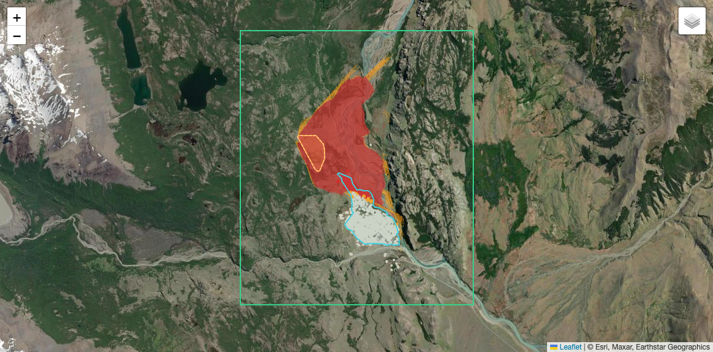
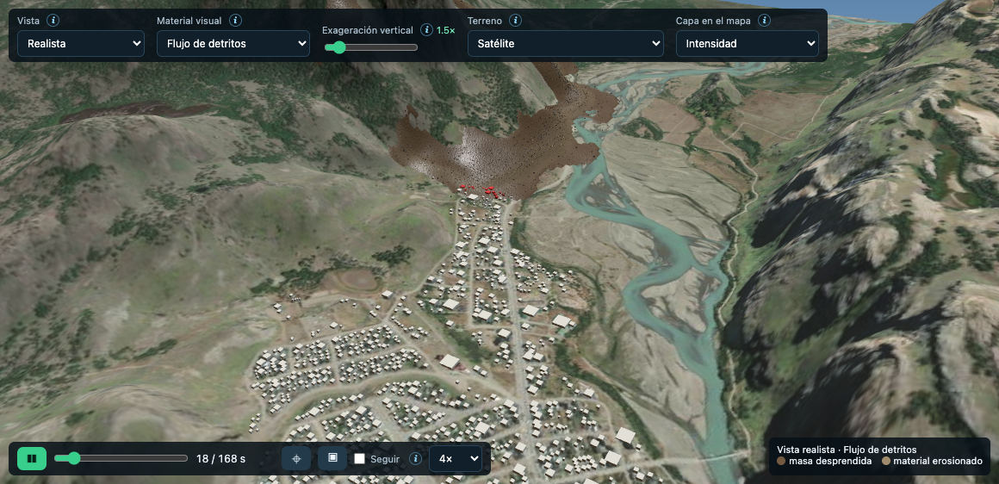
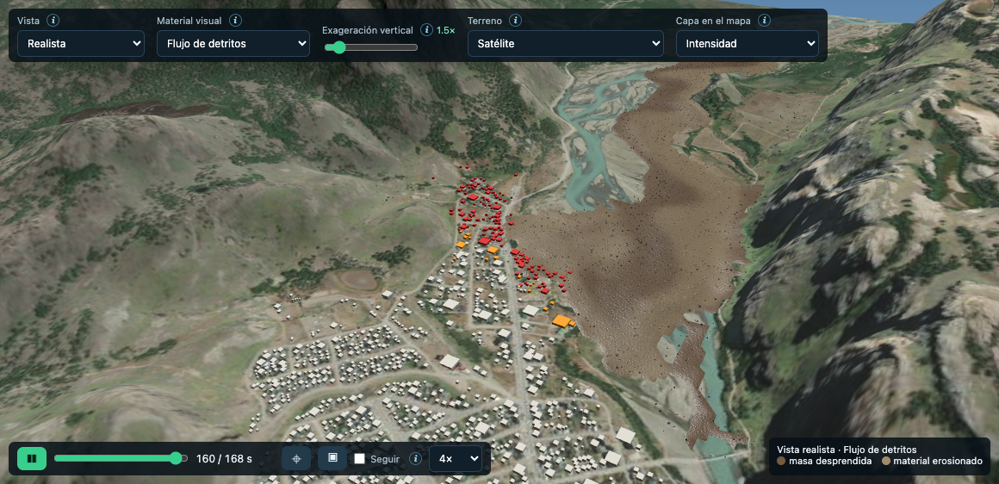

# Ejemplo: El Chaltén — flujo de detritos desde el escarpe oeste (hipotético)

> **Escenario hipotético.** No representa un evento ocurrido ni un pronóstico, y no reemplaza un estudio de amenaza. Es un caso de demostración para mostrar cómo el simulador cruza un desprendimiento con los elementos expuestos de una localidad real.

## Cómo ejecutarlo

En la app: **Ejemplos → "El Chaltén — flujo de detritos desde el escarpe oeste (hipotético)" → ▶ Cargar y simular**. En una GPU integrada tarda ~2–3 min. Todos los parámetros quedan cargados en el formulario, así que se pueden modificar antes de simular.

Archivo del escenario: [`frontend/examples/el_chalten.json`](../frontend/examples/el_chalten.json). También se puede enviar directo a la API (`POST /api/simulate` con el objeto `params`).

## Por qué El Chaltén y por qué "como en Nepal"

El Chaltén (Santa Cruz) comparte con los valles del Himalaya nepalí los factores que producen flujos de detritos destructivos:

- **Relieve abrupto sobre el poblado.** El casco urbano (~400 m s.n.m.) está al pie de laderas y escarpes rocosos que lo superan en 300–400 m a menos de 1 km de distancia.
- **Ambiente glaciar y periglaciar.** Hay roca fracturada por congelamiento y deshielo, depósitos morénicos sueltos, deshielo estival y lluvias intensas que saturan el suelo. En Nepal cumplen ese papel el monzón y el deshielo.
- **Confluencia de ríos.** El pueblo ocupa la confluencia de los ríos de las Vueltas y Fitz Roy. Un flujo que llegue al cauce puede **endicarlo** y generar una amenaza secundaria (lago temporal y ruptura), una cascada típica de eventos como el de Melamchi (Nepal, 2021).

## Escenario

| Elemento | Valor | Criterio |
|---|---|---|
| Zona de cálculo | −72,925 / −72,860 · −49,345 / −49,295 (4,7 × 5,5 km) | Incluye el escarpe, el casco urbano completo y ambos ríos, con margen para que no salga material del dominio |
| Terreno | AWS Terrain Tiles (~30 m) | Siempre disponible y sin API key; se puede cambiar a COP30 |
| Área de desprendimiento | 23 ha sobre el escarpe al O-NO del pueblo | Celdas con pendiente > 30°, cota > 560 m y orientación hacia el pueblo (descenso medio al ESE, 112°). Cotas 563–814 m, pendiente media 44° |
| Volumen | **1,39 M m³** (espesor medio 6 m, domo, máx. 11 m) | Falla de escarpe severa pero verosímil para una pared de ~250 m |
| Material | Flujo de detritos saturado: ρs 2650 kg/m³, n 0,40, φ 32°, **δ 12°**, η 200 Pa·s | Rangos publicados para flujos de detritos del Himalaya y los Andes (δ 8–14°) |
| Agua | **Sr 0,95**, λ inicial hidrostático, Td 120 s, κ 1,5 | Suelo casi saturado por lluvia y deshielo. κ moderado para que λ quede en 0,5–0,8, como miden Iverson y colaboradores en el cuerpo de flujos reales |
| Erosión | 1 m erosionable, Es 0,003 1/m, v crítica 1 m/s. **Sin erosión en el casco urbano** | Piedemonte y llanura aluvial con sedimento suelto; suelo urbano compactado |
| Solver | MPM 3D, dx 9 m, 3 partículas por celda y eje, hasta 240 s (se detiene solo cuando el material queda en reposo) | Máxima resolución que admite el presupuesto de memoria de la GPU en esta zona |
| Elementos expuestos | Polígono urbano y **1212 edificios** de OpenStreetMap | Datos reales (© colaboradores de OSM, ODbL) |

## Resultados (corrida de referencia)

### Evento

- El material cae por el escarpe y alcanza **40–55 m/s** al pie. Es un comportamiento de avalancha de detritos: la pared tiene 44° de pendiente y ~300 m de caída.
- Recorre **2,6 km** con una fricción aparente **H/L ≈ 0,17**, dentro del rango de flujos de detritos saturados de gran volumen.
- Erosiona el piedemonte y la llanura: el volumen movilizado pasa de 1,39 a **~3,2 M m³ depositados**.
- La masa queda en reposo hacia los **170 s**.

### Impacto sobre El Chaltén

| Indicador | Valor |
|---|---|
| Superficie urbana afectada | **12 ha (15% del casco)**, casi toda con intensidad alta |
| Edificios alcanzados | **~150 de 1212 (13%)**, ~130 con intensidad alta |
| Primer edificio alcanzado | **~14 s** después del inicio del desprendimiento |
| 50% de los edificios alcanzados | antes de **~25 s** |
| Profundidad en la zona afectada | p50 ~8 m, p90 ~13 m |
| Velocidad en la zona afectada | p50 ~40 m/s |
| Presión dinámica | p50 ~3 MPa. Muy por encima de los 30–100 kPa que destruyen construcciones de mampostería o madera |

El sector afectado es el **extremo norte y noroeste** del casco urbano, pegado al pie del escarpe. El resto del pueblo, hacia el sur, no es alcanzado.

### Endicamiento del Río de las Vueltas

El depósito cubre **~1,4 km del cauce del Río de las Vueltas**, con hasta **11 m** de material (p90 7 m), a partir de los **~16 s**. En la realidad eso formaría un dique natural justo aguas arriba del pueblo. Detrás del dique se acumularía agua, y su ruptura posterior produciría una crecida sobre la ribera este del casco urbano y aguas abajo. **El modelo no simula esa fase** (es monofásico y no tiene hidráulica de ríos), pero el resultado la identifica como la amenaza secundaria principal.

## Sensibilidad

Resultados con un parámetro cambiado por vez respecto del escenario base (corridas del simulador, MPM en GPU):

| Variante | Vol. liberado | Vol. depositado | Alcance | H/L | Casco urbano afectado | Edificios alcanzados (alta/media) | 1er edificio | Cauce del R. de las Vueltas obstruido (>1 m) |
|---|---|---|---|---|---|---|---|---|
| **Base** | 1,39 M m³ | 3,23 M m³ | 2,6 km | 0,17 | 12,2 ha (15%) | 152 (134/18) | 14 s | 1,43 km (máx. 11 m) |
| δ = 10° | 1,39 M m³ | 3,50 M m³ | 3,1 km | 0,14 | 12,5 ha (15%) | 158 (134/24) | 14 s | 1,73 km (máx. 9 m) |
| δ = 14° | 1,39 M m³ | 3,02 M m³ | 2,3 km | 0,19 | 12,7 ha (15%) | 162 (142/20) | 14 s | 1,17 km (máx. 9 m) |
| Sr = 0,6 (menos agua) | 1,39 M m³ | 2,91 M m³ | 2,0 km | 0,21 | 11,4 ha (14%) | 150 (130/20) | 14 s | 0,56 km (máx. 7 m) |
| Volumen ½ (espesor 3 m) | 0,69 M m³ | 2,09 M m³ | 3,0 km | 0,15 | 12,2 ha (15%) | 162 (128/33) | 14 s | 0,82 km (máx. 7 m) |

**Qué muestra:**

- **El impacto sobre el pueblo es robusto.** En todas las variantes resultan alcanzados 150–162 edificios, casi todos con intensidad alta, y el primero a los ~14 s. El sector expuesto está al pie del escarpe y lo alcanza cualquier variante razonable, incluso con la mitad del volumen: la erosión del piedemonte compensa buena parte de la diferencia.
- **Lo que más depende de los parámetros es el alcance y el endicamiento del río.** El tramo obstruido va de 0,6 km con menos agua (Sr 0,6) a 1,7 km con menor fricción (δ 10°). La amenaza secundaria (dique y crecida) es la parte más incierta del escenario, y la que más se beneficiaría de calibrar con eventos locales.
- δ 14° da un alcance menor pero algo más de edificios alcanzados, porque el material se concentra cerca del pie del escarpe en lugar de seguir por el valle.

## Interpretación y límites

- **Tiempo de aviso prácticamente nulo.** Con ~14 s entre el desprendimiento y el primer edificio alcanzado, una alerta al disparo no alcanza. La reducción del riesgo dependería del monitoreo previo del escarpe (grietas, deformación, lluvia acumulada) y del ordenamiento territorial al pie.
- **Resolución.** El espesor medio (6 m) es menor que dx (9 m), así que la masa queda sub-resuelta en la vertical. La profundidad y la velocidad son indicativas, y la huella es más robusta que los valores puntuales.
- **Terreno de ~30 m.** No resuelve calles, muros ni edificios como obstáculos: los edificios se evalúan como puntos expuestos, no como barreras.
- **Mezcla monofásica.** El agua no drena ni se separa del sólido, y no se simula el lago del dique ni su ruptura.
- **Variabilidad numérica.** Entre corridas idénticas puede haber diferencias de algunos edificios, por el orden de las operaciones atómicas en la GPU.
- **Sin calibrar contra eventos locales.** Para usarlo en planificación habría que calibrar δ, λ y la erosión con eventos de la región (alcances, espesores de depósito) y usar un DEM de mayor resolución (LiDAR o fotogrametría).
