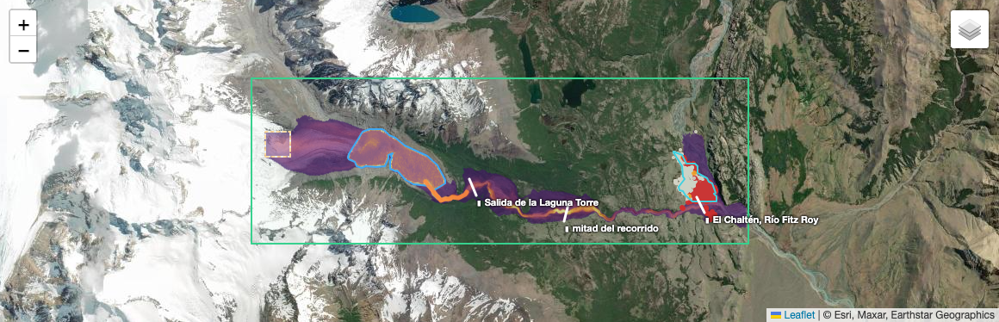
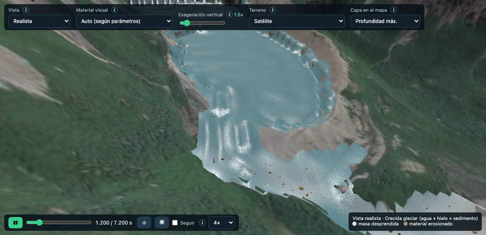
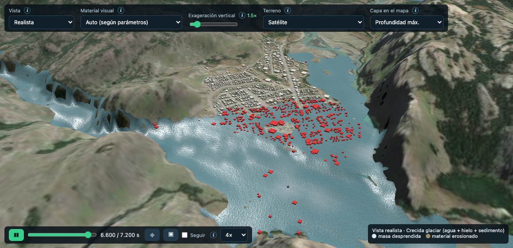

# Ejemplo: GLOF de la Laguna Torre — del Glaciar Grande a El Chaltén (hipotético)

> **Escenario hipotético.** No representa un evento ocurrido ni un pronóstico, y no reemplaza un estudio de amenaza. Muestra cómo el simulador encadena, en una sola simulación física, las etapas de un desborde de lago glaciar (GLOF) como los del Himalaya.

## Antecedentes: el Glaciar Torre hoy

Datos de **Schmidt, Winocur y Pitte (2023)**, que reconstruyeron la evolución del Glaciar Torre entre 1968 y noviembre de 2022 con fotografías aéreas (IGN 1968 y 1981), imágenes satelitales y fotografías históricas desde 1934:

| Indicador | Valor medido |
|---|---|
| Composición | Tres lenguas: **Torre, Adela y Grande** (Lliboutry 1953), entre 49°16′ y 49°20′ S |
| Superficie del glaciar | 26,2 km² (1984) → 24,6 km² (2005) → **~22 km²** (2018–2022). Pérdida de ~4 km² (15–20 %) desde 1968 |
| Retroceso del frente | **~350 m** (O–E) desde 1968, acelerado desde 2002. En 2007 el frente perdió contacto con el afloramiento de roca aborregada que lo frenaba. En 2019–2022 la tasa se duplicó |
| Adelgazamiento | 50–60 m (1952–2009) + 10–15 m (2009–2022) = **60–75 m** |
| Laguna Torre | Creció **~0,6 km²** (1968–2022). Se forman lagunas marginales entre el hielo y las laderas |
| Laderas | Al perder el soporte basal del hielo, las laderas del valle se desestabilizan progresivamente ladera arriba |
| Clima | El Chaltén (400 m): 550 mm/año y ~7 °C de media. Hacia el oeste: 1000–2000 mm/año y ~6 °C |

**Qué implica para este escenario:**

- El DEM (SRTM, año 2000) muestra un glaciar más grueso y más avanzado que el actual. Con las tasas medidas, en 2000 el hielo tenía unos **18–25 m más de espesor** que en 2022, y la mayor parte de los 350 m de retroceso ocurrió después de 2002. Por eso el acantilado de hielo sobre el lago es más alto en el modelo que en la realidad, y la ola de impulso probablemente queda sobreestimada.
- El proceso que el trabajo documenta como activo es la **desestabilización de las laderas** del valle por la pérdida de soporte glaciar y el crecimiento del lago. Un deslizamiento de ladera hacia la laguna es un desencadenante alternativo al de la avalancha de seracs.

**Créditos:** Schmidt, D. I., Winocur, D. A. y Pitte, P. (2023). *Dinámica del Glaciar Torre y su relación con el cambio climático, PNLG, Santa Cruz.* Actas de Trabajos Completos del E-ICES 18. UBA · IDEAN (UBA-CONICET) · IANIGLA-CONICET. [ri.conicet.gov.ar/handle/11336/282104](https://ri.conicet.gov.ar/handle/11336/282104)

## Cómo ejecutarlo

En la app: **Ejemplos → "Laguna Torre → Río Fitz Roy → El Chaltén — GLOF…" → ▶ Cargar y simular**. Son 2 horas de evento y en una GPU integrada tarda ~40 min.

Archivo del escenario: [`frontend/examples/laguna_torre_glof.json`](../frontend/examples/laguna_torre_glof.json).

## La cascada que se simula

1. **Avalancha de hielo.** Se desprenden los seracs de la cascada de hielo del Glaciar Grande (1250–960 m, ~35° de pendiente).
2. **Recorrido por la lengua.** La masa baja ~1,6 km por la lengua del glaciar (~4°) y cae por el frente, un acantilado de hielo, a la Laguna Torre (632 m).
3. **Ola de impulso.** El impacto empuja el agua: hielo y agua comparten la grilla MPM, así que el momento se transfiere sin acoplamientos artificiales.
4. **Rotura de la morena.** Cuando la ola llega al desagüe se abre una brecha en la morena, que se profundiza durante 15 min.
5. **Vaciado del lago.** El agua sale por la brecha y baja por el Río Fitz Roy (10,2 km y 242 m de desnivel), erosionando su lecho.
6. **Llegada a El Chaltén.** La crecida alcanza el pueblo en la confluencia con el Río de las Vueltas.

## Datos y criterios

| Elemento | Valor | Criterio |
|---|---|---|
| Zona de cálculo | −73,066 / −72,868 · −49,345 / −49,302 (14,4 × 4,8 km) | Del glaciar a El Chaltén, con el valle del Fitz Roy completo |
| Terreno | AWS Terrain Tiles (~30 m, SRTM 2000) | En el DEM, el glaciar es anterior al retroceso actual: su frente queda como un acantilado de hielo de ~150 m sobre el lago. Según Schmidt et al. (2023), desde 2000 el hielo se adelgazó ~18–25 m y el frente retrocedió la mayor parte de sus 350 m |
| Laguna Torre | Polígono de OSM (2,38 km²), nivelada a **632 m** | 632 m es la cota del umbral del desagüe en el DEM |
| Agua | **47 M m³**: capa activa de 20 m con fondo plano a 612 m | Sin batimetría, se representa el agua que puede drenar por una brecha de 25 m. El resto del lago no interviene |
| Avalancha de hielo | **6,3 M m³**, ρ 900 kg/m³, φ 25°, **δ 4°**, ξ 2000 m/s² | Las avalanchas de hielo tienen fricción aparente muy baja. Para la escala, las catastróficas documentadas llegan a decenas o cientos de M m³ (Kolka 2002, Chamoli 2021) |
| Brecha de la morena | 25 m de profundidad y 120 m de ancho. Empieza a los **90 s** (llegada de la ola) y se completa a los **16,5 min** | Prescrita, como es habitual en estudios de GLOF: su mecánica depende de la estructura interna de la morena |
| Cauce del Fitz Roy | Grabado en el DEM con perfil monótono: 40 m de ancho en el tramo de la brecha y **cauce de conducción equivalente de 100 m × 8 m** aguas abajo. Lecho erosionable de 2 m | El valle tiene una garganta de 40–80 m de ancho (y un salto de ~40 m) que, con celdas de 20 m, queda de 2 celdas y actúa como un dique falso: en una primera corrida sin este ajuste, el agua se embalsaba hasta 95 m detrás de la garganta. El cauce equivalente le da la capacidad de conducción de la garganta real |
| Morena | 5 m erosionables alrededor del desagüe | El sobrepaso de la ola puede erosionarla |
| Rugosidad | Voellmy **ξ = 800 m/s²** para el agua y el sedimento | Equivale a Manning n ≈ 0,04, típico de ríos de montaña |
| Solver | MPM 3D, dx 20 m, 2 partículas por celda y eje, 2 h de evento | ~18 M de nodos en la GPU |
| Estaciones de aforo | Salida del lago (km 1,5), mitad del recorrido (km 5) y El Chaltén (km 9,6) | Secciones de 500 m de ancho, perpendiculares al río |
| Elementos expuestos | Casco urbano y 1212 edificios (OSM) | Los mismos del ejemplo del escarpe |

## Resultados

Corrida de referencia: MPM 3D en la GPU (Metal), 18 M de nodos, 2 h de evento.

### Cronología (desde el desprendimiento de los seracs)

| Tiempo | Qué pasa |
|---|---|
| 0 – 1 min | La avalancha de hielo (6,3 M m³) baja por la lengua del glaciar a 40–46 m/s |
| ~1 min | Cae por el frente del glaciar a la Laguna Torre y genera la ola de impulso |
| 1,5 min | La ola llega a la morena y empieza la brecha |
| 16,5 min | La brecha está completa (25 m). Se evacuan 2,9 M m³ de morena |
| **37 min** | **Caudal pico a la salida del lago: ~8.700 m³/s** |
| 34 min | El frente de la crecida pasa por la mitad del recorrido (km 5) |
| **~76 min** | **La crecida llega al Río Fitz Roy a la altura de El Chaltén** |
| ~82 min | Primer edificio alcanzado |
| ~100 min | Mitad de los edificios alcanzados |
| 116 min | Caudal pico en El Chaltén: ~2.700 m³/s (todavía ~2.000 m³/s a las 2 h) |

### Hidrogramas (estaciones virtuales)

| Estación | Caudal pico | Hora del pico | Volumen que pasó en 2 h |
|---|---|---|---|
| Salida del lago (km 1,5) | ~8.700 m³/s | 37 min | 26 M m³ |
| Mitad del recorrido (km 5) | ~5.100 m³/s | 75 min | 15 M m³ |
| El Chaltén (km 9,6) | ~2.700 m³/s | 116 min | 3,2 M m³ |

El pico se **atenúa** aguas abajo, de 8.700 a 2.700 m³/s. El valle almacena agua en la llanura aluvial y detrás de la garganta del Fitz Roy. El caudal pico a la salida del lago (~9.000 m³/s para ~47 M m³ movilizables) cae dentro del rango de las fórmulas empíricas para GLOF por rotura de morena, que van de ~1.000 a varias decenas de miles de m³/s según el autor.

### Impacto sobre El Chaltén

| Indicador | Valor | Confianza |
|---|---|---|
| Tiempo hasta la llegada al pueblo | **~76–82 min** desde el colapso (~65 min desde que empieza la brecha) | Media: depende sobre todo de la rugosidad y de la brecha |
| Edificios alcanzados por agua | **~570 de 1212 (47%)**, en la mitad sur del casco, sobre el Río Fitz Roy y la confluencia | Baja–media: la huella es aproximada |
| Superficie urbana alcanzada | ~43 ha (52%) | Baja–media |
| Profundidad en el pueblo | 2,5–5 m en la mayoría de las celdas | **Baja**: es la resolución del modelo (1 partícula = 2,5 m), no un valor medido. Probablemente sobreestima la profundidad del llano |
| Velocidad en el pueblo | p50 ~2,3 m/s, p90 ~3,5 m/s | Media |

**Lectura:** la parte robusta del resultado es la **cronología**. A diferencia del colapso del escarpe (14 s), acá hay **más de una hora entre el desencadenante y la llegada al pueblo**. Con monitoreo del glaciar y del lago y un sistema de alerta temprana, esa ventana alcanza para evacuar la franja ribereña.

## Lo que hay que mejorar para resultados cuantitativos

- **Resolución del agua en el pueblo.** Con dx 20 m y 2 partículas por celda y eje, cada partícula de agua equivale a 2,5 m de lámina. Para profundidades confiables en el llano hace falta ppc 3 (0,7 m por partícula) o un dominio anidado más fino alrededor del pueblo.
- **Artefactos locales en angosturas.** En la garganta y en la brecha, las partículas se apilan transitoriamente y la profundidad máxima puntual se infla: la superficie del agua llega a quedar por encima del nivel del lago. Esos valores máximos locales no son físicos. Los caudales y volúmenes no se ven afectados (el balance de masa cierra).

## Interpretación y límites

- **La brecha es el supuesto que más pesa.** Su profundidad, su ancho y su tiempo de formación controlan el caudal pico y el volumen que sale. Una brecha más lenta o más chica atenúa mucho la crecida; una más rápida la agrava.
- **Sin batimetría.** El lago se representa con su capa activa. Una laguna más profunda no cambia el volumen que puede salir (lo limita la cota de la brecha), pero sí la ola: en aguas más profundas las olas son más rápidas y pierden menos energía.
- **DEM de 2000 y de 30 m.** El glaciar ha retrocedido desde entonces (~350 m de frente desde 1968 y 60–75 m de adelgazamiento desde 1952; Schmidt et al. 2023) y el cauce angosto no está bien resuelto: por eso se graba el río con un cauce de conducción equivalente. Sin ese ajuste, la garganta del Fitz Roy (40–80 m de ancho, 2 celdas) embalsaba la crecida. Para un estudio real hace falta un DEM de 1–5 m del cauce (LiDAR o fotogrametría con dron). La llanura aluvial almacena agua en depresiones que pueden no existir tal cual en la realidad.
- **Agua y sedimento se mezclan solo a través de la grilla.** No hay transporte de sedimento en suspensión ni cambio de reología a medida que la crecida se carga. Una crecida real puede pasar a flujo hiperconcentrado o de detritos.
- **Velocidad de propagación.** Depende de la rugosidad (ξ). Con n ≈ 0,04 el frente avanza a 1,5–3 m/s; con un cauce más liso, la crecida llegaría antes.
